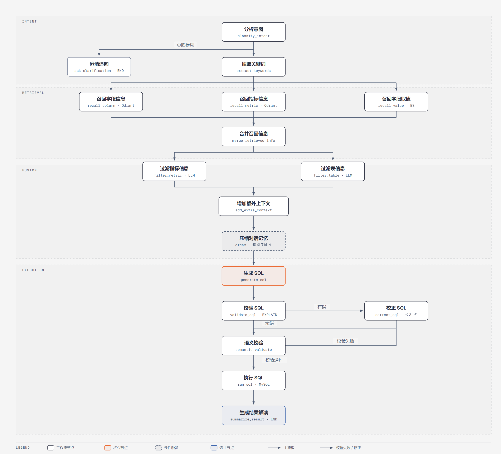

<div align='center'>
  <h1>🧚 DataSprite 问数精灵</h1>
  <h4>NL2SQL 智能数据分析系统</h4>
  <p><em>自然语言提问 → 自动生成 SQL → 流式返回结果</em></p>
  <p>
    <a href="https://github.com/Nakoem/datasprite/actions/workflows/ci.yml">
      
    </a>
  </p>
</div>

<div align='center'>


</div>

---

## 📖 项目简介

DataSprite 是一个基于 NL2SQL 的智能问数系统。用户用自然语言提问（如"华北地区上季度 GMV 是多少"），系统自动完成**关键词抽取 → 多路召回 → 上下文组装 → SQL 生成与校验 → 流式返回结果**的全链路处理。

> 💡 基于 [shopkeeper-agent](https://github.com/didilili/shopkeeper-agent) 学习并二次开发

---

## ✨ 项目亮点

- **NL2SQL 全链路闭环**：关键词抽取 → Qdrant 语义检索 + ES 全文检索 → 过滤合并 → LLM SQL 生成 → SQL 校验修正 → 执行 SQL 并返回可视化结果，17 个节点端到端自动化，用户只需说人话。

- **混合检索架构**：MySQL 存结构化元数据 + Qdrant 做字段/指标语义向量召回 + ES 做字段取值全文匹配，三库协同解决"用户说的词对应哪个字段、哪个值"的核心问题，避免 LLM 裸写 SQL 的幻觉风险。

- **异步并发与高可用**：三路数据源 SQLAlchemy async 并行召回，减少串行等待；Redis 缓存 Embedding 向量（7 天 TTL）与热点查询结果（1 小时 TTL），解耦 LLM 调用与结果消费，避免高峰期阻塞 —— 缓存全程 fail-open（Redis 故障自动跳过 + 30s 熔断，不影响主链路）。

- **三层兜底策略**：意图兜底（模糊请求主动追问澄清）→ 执行兜底（SQL 修正重试 ≤3 次；摘要 LLM 故障时降级跳过，用户仍拿到原始表格数据）→ 全局兜底（管道超时熔断 + 全局异常 JSON 兜底），任何异常都有响应。

- **工程化交付**：OmegaConf + YAML 配置外置，Docker Compose 一键启动全部基础服务，API 限流保护（令牌桶双层）+ SQL 只读限制与行数上限控制 + 全局异常兜底 + 健康检查端点，loguru + request_id 记录系统运行日志，出问题有据可查。

---

## 🏗️ 架构总览



> 完整交互版（矢量，可浏览器缩放）：[langgraph-workflow.html](langgraph-workflow.html)

---

## 🛠️ 技术栈

| 类别 | 技术 |
|:---|:---|
| 🧠 大模型 | qwen3.7-max（通义千问） |
| 🔢 Embedding | BGE-large-zh-v1.5（1024维） |
| 🔍 向量检索 | Qdrant（HNSW 索引） |
| 📄 全文检索 | Elasticsearch（IK 中文分词） |
| 🗄️ 数据库 | MySQL 8.0（星型模型：1事实表 + 4维度表） |
| 🔗 工作流 | LangGraph（17节点编排） |
| 🌐 后端 | FastAPI + SSE 流式推送 |
| 🎨 前端 | React 19 + TypeScript + Tailwind CSS |
| 🐳 部署 | Docker Compose |

---

## ✨ 界面动效

前端用 [border-beam](https://github.com/Jakubantalik/border-beam)（纯 CSS conic-gradient 流光边框）做核心高光点亮，按「交互优先、装饰从轻」分层：

| 位置 | 强度 | 说明 |
|:--|:--:|:--|
| 输入框（聚焦） | 0.6 | 核心交互，最亮 |
| 流式骨架屏卡 | 0.55 | 问数进行中 |
| AI 摘要卡 | 0.5 | 完工高光 |
| 流程活跃节点 | 0.5 | 引导视线 |
| 登录按钮 | 0.45 | 门面，略收 |
| 结果表 / 图表卡 | 0.4 | 数据区，克制 |
| 数据来源卡 | 0.35 | 最静，不抢戏 |

> ⚠️ **border-beam 1.3.0 会给每个实例内联 `<style>`**：在卡片 / `div` 里藏得住看不到，但**侧边栏 `menu > li` 列表会把 CSS 文本摊成可见内容**，所以列表 / menu 上不要用它，只适合卡片类容器。

---

## 🚀 快速启动

包管理统一用 **uv**（`pyproject.toml` + `uv.lock`，Python >= 3.14）。

### 环境要求

- Python 3.14+（`uv` 包管理，见 [uv](https://docs.astral.sh/uv/)）
- Docker Desktop
- Node.js 20+ / pnpm
- 基础设施：MySQL + Qdrant + Elasticsearch（Python 依赖里还有 Embedding 服务）

### 1. 安装依赖

```bash
uv sync
```

### 2. 启动基础设施

```bash
cd docker
docker compose up -d
# 启动 MySQL + Qdrant + Elasticsearch + Embedding 服务
```

### 3. 配置环境变量

```bash
cp .env.example .env
# 编辑 .env，至少填入 LLM_API_KEY（DashScope API Key），其余可留默认
```

### 4. 构建元数据知识库（首次运行必做）

```bash
uv run python app/scripts/build_meta_knowledge.py --config conf/meta_config.yaml
# 把 meta 库的表结构灌进 Qdrant + ES，没跑这步问数召回会全空
```

### 5. 启动后端

```bash
uv run uvicorn main:app --reload --port 8000
# 访问 http://localhost:8000/docs 查看 API 文档
# /api/ask（同步 JSON）走 X-API-Key 头鉴权；/api/query（SSE 流式）走登录 JWT
```

### 6. 启动前端

```bash
cd frontend
pnpm install && pnpm dev
# 访问 http://localhost:5173
```

### 本地单跑整条工作流（无需起后端）

```bash
uv run python -m app.agent.graph   # 直连各客户端，跑一次真实问数
uv run python app/scripts/run_evaluation.py   # 问数评测，报告落 docs/evaluations/
```

---

## 📁 项目结构

```
datasprite/
├── app/
│   ├── agent/          # LangGraph 工作流（17个节点 + 图编排）
│   ├── api/            # FastAPI 路由 + 依赖注入
│   ├── clients/        # MySQL/Qdrant/ES 客户端
│   ├── entities/       # 领域实体
│   ├── models/         # 数据模型
│   ├── repositories/   # 数据仓储层
│   ├── services/       # 业务服务层
│   └── scripts/        # 工具脚本
├── conf/               # 配置文件
├── docker/             # Docker Compose + SQL 初始化
├── frontend/           # React 前端
├── prompts/            # LLM 提示词模板
└── main.py             # 应用入口
```

---

## 🧯 容错与兜底

生产链路里每个"可能炸"的环节都有兜底——**预设整体思路是：宁可给用户看未过滤结果，也不让下游饿死；宁可放行出错 SQL，也不让用户永远转圈。**

| 环节 | 兜底机制 | 配置 |
|:---|:---|:---|
| 🧠 LLM 单次调用 | 请求超时 + 客户端自动重试（指数退避）+ **主模型失败降级备用模型** | `conf/app_config.yaml` → `llm`: `request_timeout: 60` / `max_retries: 3` / `fallback_model`（默认 qwen-plus） |
| ⏱️ 整条问数管线 | `asyncio.wait_for` 整体超时，防 LLM 假死导致请求永久挂起（SSE 也一样有超时） | `llm.query_timeout: 120` |
| 🔄 SQL 校验 | `validate_sql` 用 `EXPLAIN` 校验 → 失败进 `correct_sql` 修正，**最多 3 次**；超限则直接执行（让错误暴露给用户，而不是静默） | `graph.py` `MAX_CORRECT_RETRIES = 3` |
| 🧩 召回 / 过滤节点 | LLM 输出格式异常时**不过滤、保留全部候选**（宁可漏选不可清空，防下游无表无指标可用） | `_llm_guard` 防御 |
| 🚦 限流 | Redis 令牌桶双层限流；**Redis 挂掉 → fail-open 直接放行**（限流器故障不影响主业务），加 30s 熔断防假死 | `rate_limit` 段；桶状态存 Redis |
| 💾 消息持久化 | 用户/助手消息保存失败仅记录日志，**不阻塞查询结果返回** | `query_service.py` 各 `try/except` |
| 🚨 全局异常 | 中间件兜底，统一错误响应 + 带 `request_id` 落日志 | `main.py` |
| 🧠 会话记忆 | 多轮上下文经 `dream` 节点压缩，防 context 溢出；`recursion_limit` 保护超长链路 | `dream` 节点 |

---

## 📜 运行日志

日志统一用 **loguru**，且必须 `from app.core.log import logger`（⚠️ 不要裸导入 `loguru` —— 该实例会注入 `request_id`，裸导入会因 `extra` 缺字段导致日志静默丢失）。

- **链路标识**：每个请求注入 `request_id`（`ContextVar`，并发协程互不干扰）；**若上游带了 `X-Request-Id` 头则沿用**（feishu-bridge → DataSprite 全链路贯通），否则 UUID 自动生成
- **输出位置**：
  - 控制台（`app_config.logging.console`）
  - 文件：`logs/app.log`（`logging.file`: `rotation: 10 MB` 按大小轮转、`retention: 7 days` 自动清理、UTF-8）
- **日志格式**：`时间 | 级别 | request_id | 模块:函数:行号 | 内容`
- **配置**：`conf/app_config.yaml` → `logging:` 段（开关 / 级别 / 路径 / 轮转 / 保留期）
- **特殊日志**：SQL 执行日志（SQLAlchemy event 输出，`/* select#N */` 前缀可对应到第几条）、LangGraph 检查点、节点进度事件（SSE 里的 `progress` chunk）
- **审计（#27）**：SQL 全链路审计落 `audit_logs` 表（谁问了什么 → 生成什么 SQL → 耗时 → 结果行数），不可篡改，可从 `/api/audit/*` 查看

---

## 📝 后续规划

> 完整清单与进度（当前 **31 / 37**）见 [TODO.md](TODO.md)，此处只列要点，避免清单漂移。

### ✅ 已完成

- [x] SQL 修正循环（correct → re-validate）
- [x] 多轮对话上下文（conversation_id 透传 + 记忆压缩）
- [x] 可视化图表（6 种图表自动检测，支持后端 PNG 生成）
- [x] 结果导出 CSV/Excel
- [x] 查询历史 + 收藏（会话列表）
- [x] 全链路 Token 归集（一次问数 token 记账 + /api/ask 透传 token_usage）

### 📌 待办

- [ ] ⏰ 定时报告（定时 SQL + 飞书推送，#13）
- [ ] 📱 微信小程序版（Taro 复用 React 代码，#32）
- [ ] 📡 多端接入 Channel 抽象层（微信/钉钉，#23）
- [ ] 🔄 AgentScope 企业级外壳迁移（多租户 / 沙箱，v1.0 稳定后评估，#31）
- [ ] 前端 UI 持续重设计

---

## 📄 License

MIT © 2026
